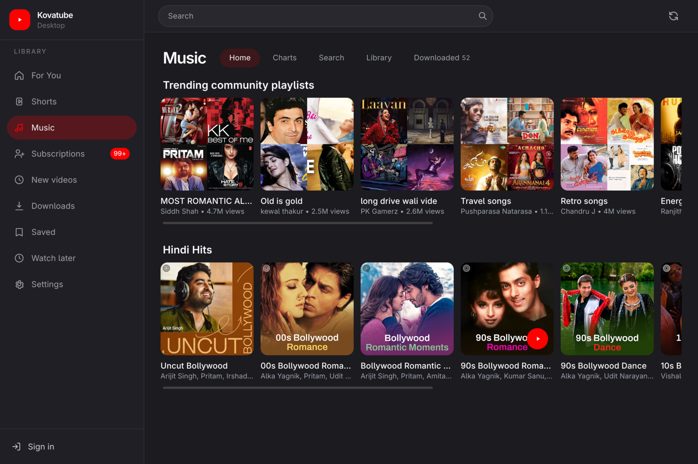
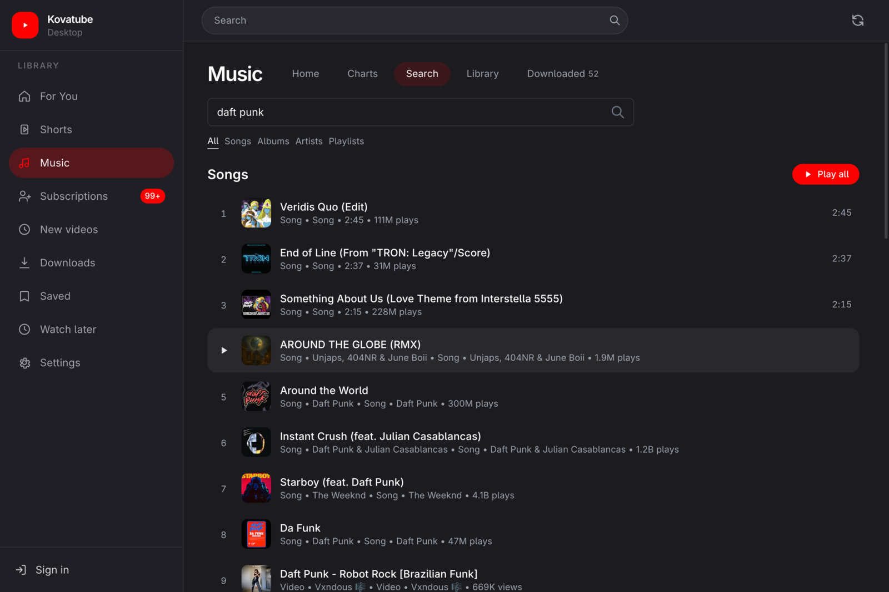
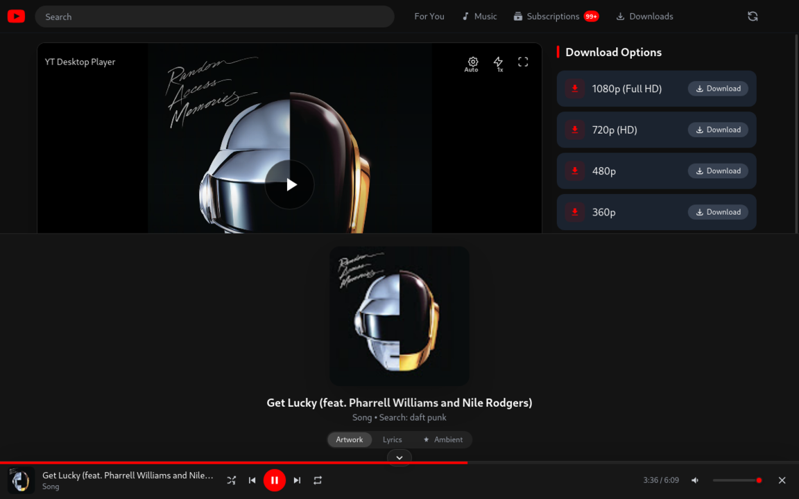
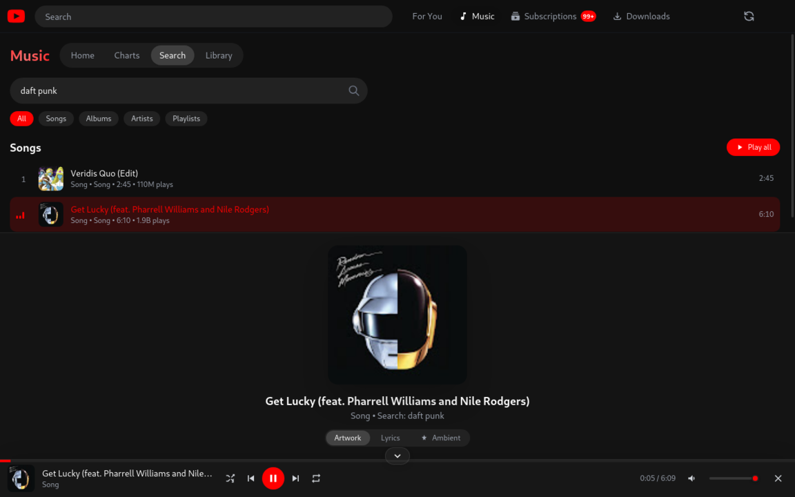
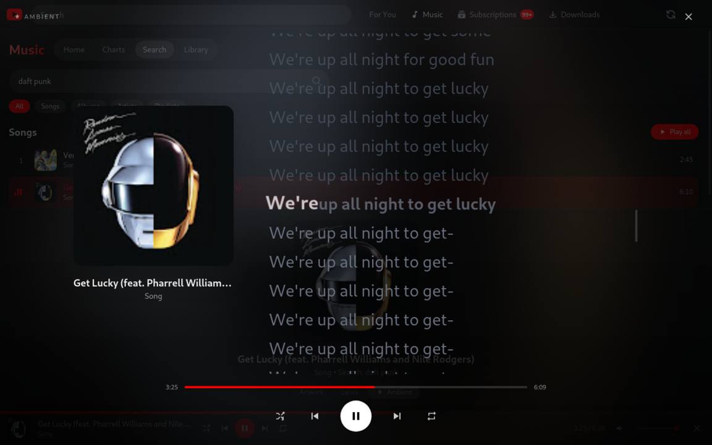
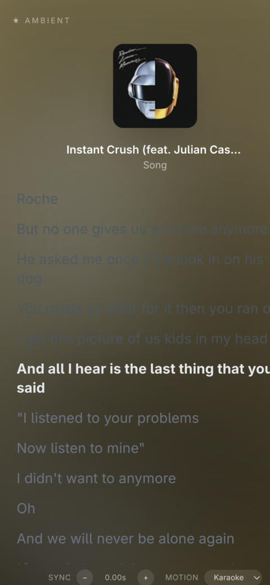

<div align="center">

# Kovatube

**YouTube and YouTube Music, in a clean desktop app.**

A fast, minimalist desktop client that brings video and music together — with a persistent player, word-by-word synced lyrics, downloads, and your signed-in library.

[](#-getting-started)
[](https://www.electronjs.org/)
[](https://react.dev/)
[](https://tailwindcss.com/)
[](#-license)

</div>

---

## ✨ Overview

Kovatube is a desktop app for **watching YouTube** and **listening to YouTube Music** without a browser full of tabs. It plays video and music, keeps a queue that survives while you browse, and follows along with the lyrics — highlighting the current line and each word as it's sung.

It's built on Electron + React, talks to YouTube's InnerTube API directly, and uses `yt-dlp` as a fallback/for downloads. Sign in with your Google account to get your real subscriptions, For You feed, and music library.

---

## 📸 Screenshots

<div align="center">

**YouTube Music — browse**
<br>


**Search results** &nbsp;·&nbsp; **Video player**
<br>



**Now Playing** &nbsp;·&nbsp; **Ambient mode**
<br>



**Ambient mode (mobile layout)**
<br>


</div>

---

## 🎬 Features

### Video
- **Watch & search** YouTube videos with a native player and YouTube-style keyboard shortcuts.
- **For You feed** and **Subscriptions** from your signed-in Google account.
- **Shorts**, **New videos**, **Channel** pages, and **Saved videos**.
- **Playback control** — seek, volume, fullscreen, and playback **speed** (0.25× steps).
- **Keyboard shortcuts** — `Space`/`K` play-pause, `J`/`L` ±10s, `←`/`→` ±5s, `↑`/`↓` volume, `M` mute, `F` fullscreen, `0–9` jump to %, `>`/`<` speed.

### Music
- Full **YouTube Music** section: **Home**, **Charts**, **Search**, and your signed-in **Library**.
- Browse **songs, albums, artists, playlists** (and album/playlist detail pages).
- **Audio player** with a **persistent mini-player** that keeps playing while you browse the rest of the app.
- **Queue** with **shuffle**, **repeat** (all / one / off), **prev/next**, and **auto-advance**.
- **Full-screen player** — a large cover-art view with a seek bar, the full transport and volume; toggle artwork/lyrics, or jump to ambient mode. Open it with `F` or the expand icon on the mini-player.
- **Keyboard shortcuts** — `Space`/`K` play-pause, `J`/`L` ±10s, `←`/`→` ±5s, `↑`/`↓` volume, `M` mute, `N`/`P` next-previous, `S` shuffle, `R` repeat, `F` full screen, `A` ambient mode, `0–9` jump to %, `Home`/`End` start-end, `+`/`-` volume.
- Music and video coordinate automatically so only one plays through the speakers at a time.

### Lyrics
- **Synced lyrics** that follow the song — the current line is highlighted and auto-centred.
- **Word-by-word karaoke** highlighting with a subtle pop animation on the active word.
- Lyrics sourced from YouTube Music and the [LRCLIB](https://lrclib.net/) community database, with per-word timing interpolated within each line.
- **Ambient mode** — a full-screen, immersive view with the cover art over a blurred backdrop of the album, plus the lyrics and transport controls.

### Downloads & offline
- **Download** videos/audio, with a fast InnerTube path and a `yt-dlp` fallback.
- **Music and videos kept apart** — songs and videos live in separate folders under the app data directory (on an existing Linux install, that is still `~/.config/Kovatube/downloads`).
- **Separate downloads pages** — **Video Downloads** lists only videos; songs live on **Music Downloads** (also reachable from Music → Downloaded), with playlists, tracks, lyrics and in-progress song downloads.
- **Playlist & album downloads** — each song saved as MP3 with its lyrics alongside; the playlist shows up as one entry with its songs in order.
- **Auto-sync playlists** — songs you add to a downloaded playlist later are fetched and downloaded automatically (checked at launch and every 15 minutes, or on demand with **Sync now**). Toggle it per playlist.
- **Smart Download** — two **independent** sources, each with its own toggle and its own download budget: auto-grab videos from your **For You** recommendations, and/or auto-download YouTube links you **copy to the clipboard**. Counters are per source and can be reset in Settings; a failed or cancelled download gives its slot back.
- **Offline playback** of downloaded media.

### Look & feel
- Minimalist **light/dark** UI with a **glass** aesthetic where it counts.
- Smooth, tasteful animations and skeletons — no layout jank.
- Window chrome hidden where possible for a focused, app-like experience.

---

## 🧱 Tech stack

| Layer | Technology |
| --- | --- |
| Shell | [Electron](https://www.electronjs.org/) 28 |
| UI | [React](https://react.dev/) 18 + [React Router](https://reactrouter.com/) 6 |
| Build | [Vite](https://vitejs.dev/) 5 (`vite-plugin-electron`) |
| Styling | [Tailwind CSS](https://tailwindcss.com/) 3 |
| Media | HTML5 audio/video + [hls.js](https://github.com/video-dev/hls.js/) for HLS relays |
| Data | YouTube **InnerTube** API, [LRCLIB](https://lrclib.net/) for synced lyrics, `yt-dlp` for downloads |

---

## 🚀 Getting started

### Prerequisites
- **Node.js** 18+ and npm
- **`yt-dlp`** and **`ffmpeg`** on your `PATH`, or placed in `bin/` (`yt-dlp.exe` and `ffmpeg.exe` on Windows)
  ```bash
  pipx install yt-dlp   # or: sudo pip install yt-dlp
  ```

### Install & run (development)
```bash
npm install
# build the renderer + main process, then launch Electron
npx vite build
./node_modules/electron/dist/electron .
```

### Desktop packages
```bash
npm run electron:build:linux   # release/Kovatube-1.0.0-x86_64.AppImage
npm run electron:build:win     # Windows NSIS installer
npm run electron:build:mac     # dmg + zip; run this on a Mac
```

On Linux, the NSIS installer needs Wine (`sudo dnf install wine`). Without Wine, this machine can still pack a portable Windows folder:

```bash
npx electron-builder --win zip --x64 -c.win.signAndEditExecutable=false
```

GitHub Actions (`.github/workflows/desktop.yml`) builds the AppImage, the Windows installer, and the Mac disk image when you push a `v*` tag or run the workflow by hand. Add repository secrets `CSC_LINK` and `CSC_KEY_PASSWORD` (an Apple Developer certificate) so the Mac job is signed. Without those secrets the Mac build is unsigned and Gatekeeper warns. An unsigned Windows installer runs, with a SmartScreen warning.

ffmpeg is GPL or LGPL depending on the build. Include that license if you ship an ffmpeg binary inside `bin/`.

### Android
This repository is the desktop app. Electron does not run on Android, and playback here depends on launching `yt-dlp` and `ffmpeg`. A phone version would be a separate client, distributed as a sideloaded APK rather than a Play Store app. That work starts after the Mac and Windows packages.

---

## 📁 Project structure

```
electron/
  main.js        # main process: InnerTube, music API, lyrics, downloads, playback
  preload.js     # safe IPC bridge exposed to the renderer (window.electronAPI)
src/
  components/    # UI: player, header, feeds, music, mini-player, settings…
    music/       # YouTube Music browse/search/detail + track & card components
  context/       # React context: queue, auth, settings, downloads, saved…
  index.css      # Tailwind layers + custom animations and player styles
```

---

## ⚠️ Disclaimer

Kovatube is an **unofficial, personal** client and is **not affiliated with, endorsed by, or sponsored by YouTube or Google**. It uses public YouTube/InnerTube endpoints and community lyric data. Use it for personal use and in line with YouTube's Terms of Service; you are responsible for how you use it.

## 📄 License

Released under the **MIT License** (see `package.json`). `package.json` lists the license as MIT.
